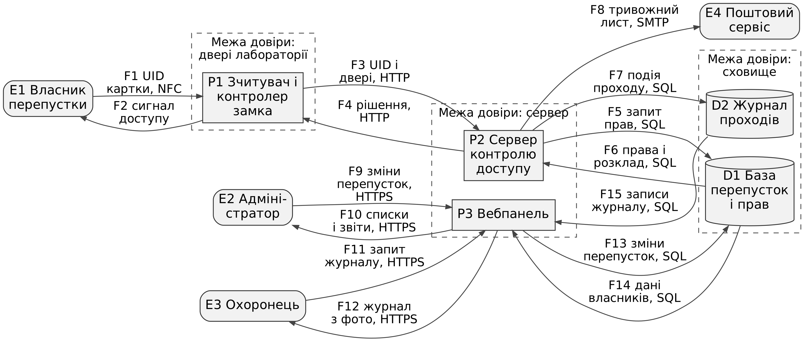

# Модель загроз: система контролю доступу до лабораторії за перепустками

**Варіант:** 4  ·  **Здобувач:** Віжуткін Ілля  ·  **Група:** ІП-31

Пріоритетна категорія STRIDE: розкриття інформації (Information disclosure). Вимоги: не менше 12 загроз, з них не менше 3 з оцінкою CVSS не нижче 7,0.

## 1. Опис системи та активи

Двері лабораторії мають зчитувач безконтактних карток і електронний замок. Кожен, кому дозволено заходити (співробітники, аспіранти, студенти), отримує картку-перепустку з унікальним ідентифікатором (UID). Зчитувач надсилає UID на сервер контролю доступу, сервер перевіряє права і розклад і повертає рішення "відкрити" або "відмовити". Кожен прохід і кожна відмова пишуться в журнал.

Адміністратор через вебпанель видає і відкликає перепустки, задає рівні доступу і розклад, дивиться звіти. Охоронець через ту саму вебпанель бачить журнал проходів у реальному часі (ПІБ і фото), щоб перевіряти, що картку приклала саме її власниця чи власник. Про тривожні події (кілька відмов поспіль, спроба з відкликаною карткою) сервер надсилає лист охороні і керівнику лабораторії через зовнішній поштовий сервіс.

Система навчальна (вигадана), усі дані умовні. Припущення про проєкт, які перевіряє модель:

1. Зчитувачі, сервер і вебпанель підключені до загальної мережі університету, окремого сегмента немає.
2. Зчитувач спілкується з сервером по HTTP без шифрування і без автентифікації.
3. API сервера на запит з UID повертає весь запис власника.
4. Вебпанель доступна по HTTPS з мережі університету, вхід за логіном і паролем.
5. Резервні копії бази щоночі копіюються на спільний мережевий диск кафедри.

| Актив | Тип | Цінність (К/Ц/Д) |
|-------|-----|------------------|
| A1. Персональні дані власників перепусток (ПІБ, фото, підрозділ, телефон) | персональні дані | В/С/С |
| A2. Ідентифікатори карток (UID), права доступу і розклад | дані авторизації | С/В/В |
| A3. Журнал проходів (хто, коли, через які двері, результат) | журнал подій | В/В/С |
| A4. Облікові записи адміністраторів і охоронців | облікові дані | В/В/С |
| A5. Службові секрети (пароль до БД, ключі сертифікатів сервера) | ключі, секрети | В/В/С |
| A6. Робота дверей: свої проходять, чужі ні | послуга | Н/В/В |

## 2. Діаграма потоків даних

Джерело діаграми - файл `dfd.mmd` (Mermaid), зображення - `dfd.png`.



Елементи: 4 зовнішні сутності (E1 власник перепустки, E2 адміністратор, E3 охоронець, E4 поштовий сервіс), 3 процеси (P1 зчитувач і контролер замка, P2 сервер контролю доступу, P3 вебпанель), 2 сховища (D1 база перепусток і прав, D2 журнал проходів), 15 потоків (F1-F15).

Межі довіри: TB1 - двері лабораторії (зчитувач у коридорі, до нього може підійти будь-хто), TB2 - сервер (P2 і P3), TB3 - сховище (D1 і D2). Усередині P3 є ще логічна межа між правами адміністратора і охоронця.

## 3. Загрози за STRIDE

| № | Елемент/потік | Категорія STRIDE | Опис загрози | Порушувана властивість |
|---|---------------|------------------|--------------|------------------------|
| T-01 | E1 Власник перепустки | S (Spoofing) | Порушник проходить з копією чужої картки. Картка передає UID без автентифікації, тому зчитувач не відрізняє копію від оригіналу, і людина без прав заходить під чужим ім'ям. | автентичність |
| T-02 | E2 Адміністратор | S (Spoofing) | Вхід у вебпанель під обліковим записом адміністратора через підбір пароля: кількість спроб входу не обмежена, другого фактора немає. | автентичність |
| T-03 | E2 Адміністратор | R (Repudiation) | Адміністратор видає доступ сторонній людині або видаляє записи, а потім заперечує це. Окремого журналу дій адміністраторів немає, а журнал проходів він може редагувати сам. | неспростовність |
| T-04 | P1 Зчитувач і контролер | T (Tampering) | Контролер замка стоїть у корпусі зчитувача із зовнішнього боку дверей, куди може підійти будь-хто. Втручання в пристрій може призвести до відкриття дверей або виведення зчитувача з ладу. | цілісність |
| T-05 | P2 Сервер | I (Information disclosure) | API перевірки картки доступне з усієї мережі університету без автентифікації зчитувача і у відповідь на UID повертає весь запис власника (ПІБ, фото, підрозділ, рівень доступу, розклад) замість простого "так/ні". Перебираючи UID, можна витягнути дані всіх власників. | конфіденційність |
| T-06 | P2 Сервер | I (Information disclosure) | При помилці API повертає повний текст винятку: версії ПЗ, шляхи до файлів, назви таблиць і полів БД. Це спрощує підготовку інших атак, зокрема на T-05. | конфіденційність |
| T-07 | P2 Сервер | E (Elevation of privilege) | Сервер перевіряє лише, чи є UID у базі, але не дивиться на термін дії перепустки і розклад. Людина з простроченою тимчасовою перепусткою (наприклад, після практики) і далі проходить у лабораторію. | авторизація |
| T-08 | P3 Вебпанель | I (Information disclosure) | Охоронцю потрібні лише ПІБ і фото того, хто проходить зараз, але сторінка власника відкривається за номером в адресі (/holders/<id>) без перевірки ролі. Змінюючи номер, охоронець бачить картки всіх власників з контактами та історією проходів. | конфіденційність |
| T-09 | P3 Вебпанель | I (Information disclosure) | Вивантаження журналу в CSV зберігається в публічній папці вебсервера з передбачуваною назвою (дата в імені файлу) і доступне за прямим посиланням без входу, поки файл не видалено. | конфіденційність |
| T-10 | P3 Вебпанель | E (Elevation of privilege) | Права ролей перевіряються лише в інтерфейсі (в охоронця просто сховані кнопки), а сервер вебпанелі приймає запит на зміну прав від будь-якого користувача, що увійшов. Охоронець може видати доступ собі або сторонній людині. | авторизація |
| T-11 | D1 База перепусток | I (Information disclosure) | Щоночі резервні копії бази без шифрування копіюються на спільний мережевий диск кафедри, до якого мають доступ усі співробітники. З копії читаються персональні дані і UID усіх карток. | конфіденційність |
| T-12 | D2 Журнал проходів | I (Information disclosure) | Журнал зберігається безстроково і не знеособлюється. З нього можна відновити розпорядок кожної людини: коли приходить, коли йде, з ким буває в лабораторії. Будь-який доступ до журналу розкриває ці дані за роки. | конфіденційність |
| T-13 | F3 (P1 до P2) | I (Information disclosure) | Запит зчитувача до сервера йде загальною мережею по HTTP без шифрування. Хто має доступ до цього сегмента мережі, бачить UID карток, номери дверей і час проходів. | конфіденційність |
| T-14 | F3 (P1 до P2) | D (Denial of service) | Зв'язок зчитувача з сервером залежить від загальної мережі університету. Перевантаження мережі, збій обладнання чи потік запитів на сервер, і двері не відкриваються ні для кого, бо своєї копії списку дозволених карток у зчитувача немає. | доступність |
| T-15 | F4 (P2 до P1) | T (Tampering) | Відповідь сервера не захищена від зміни і не автентифікована. Хто може втрутитися в обмін у мережі, той може підмінити рішення "відмовити" на "відкрити". | цілісність |
| T-16 | F8 (P2 до E4) | I (Information disclosure) | Тривожні листи містять ПІБ, фото і UID картки і йдуть через сторонній поштовий сервіс. Дані залишаються в чужих поштових скриньках, листи можуть пересилатися далі. | конфіденційність |

Розподіл: I - 8, S - 2, T - 2, E - 2, R - 1, D - 1.

## 4. Оцінювання ризиків (CVSS / матриця)

Оцінки пораховано калькулятором `cvss.py` через `scoring.py`. Імовірність P і вплив I - від 1 до 5, ризик R = P · I (1-4 прийнятний, 5-11 помірний, 12-19 високий, 20-25 неприпустимий). Ранг - місце за оцінкою CVSS, при однаковій оцінці - за R. **Жирним** виділено загрози високого ризику (CVSS не нижче 7,0).

| № загрози | Вектор CVSS | Базова оцінка | Імовірність | Вплив | Ранг ризику |
|-----------|-------------|---------------|-------------|-------|-------------|
| T-01 | CVSS:3.1/AV:P/AC:L/PR:N/UI:N/S:U/C:H/I:H/A:N | 6.1 (середній) | 3 | 4 | 9 (R = 12, високий) |
| **T-02** | CVSS:3.1/AV:N/AC:H/PR:N/UI:N/S:U/C:H/I:H/A:N | **7.4 (високий)** | 3 | 5 | 2 (R = 15, високий) |
| T-03 | CVSS:3.1/AV:N/AC:L/PR:H/UI:N/S:U/C:N/I:L/A:N | 2.7 (низький) | 2 | 3 | 16 (R = 6, помірний) |
| T-04 | CVSS:3.1/AV:P/AC:L/PR:N/UI:N/S:U/C:H/I:H/A:L | 6.4 (середній) | 2 | 4 | 8 (R = 8, помірний) |
| **T-05** | CVSS:3.1/AV:N/AC:L/PR:N/UI:N/S:U/C:H/I:N/A:N | **7.5 (високий)** | 4 | 5 | 1 (R = 20, неприпустимий) |
| T-06 | CVSS:3.1/AV:N/AC:L/PR:N/UI:N/S:U/C:L/I:N/A:N | 5.3 (середній) | 4 | 2 | 13 (R = 8, помірний) |
| T-07 | CVSS:3.1/AV:P/AC:L/PR:L/UI:N/S:U/C:H/I:H/A:N | 5.9 (середній) | 3 | 3 | 10 (R = 9, помірний) |
| T-08 | CVSS:3.1/AV:N/AC:L/PR:L/UI:N/S:U/C:H/I:N/A:N | 6.5 (середній) | 3 | 3 | 5 (R = 9, помірний) |
| T-09 | CVSS:3.1/AV:N/AC:H/PR:N/UI:N/S:U/C:H/I:N/A:N | 5.9 (середній) | 2 | 4 | 11 (R = 8, помірний) |
| **T-10** | CVSS:3.1/AV:N/AC:L/PR:L/UI:N/S:U/C:L/I:H/A:N | **7.1 (високий)** | 3 | 4 | 3 (R = 12, високий) |
| T-11 | CVSS:3.1/AV:A/AC:L/PR:L/UI:N/S:U/C:H/I:N/A:N | 5.7 (середній) | 2 | 5 | 12 (R = 10, помірний) |
| T-12 | CVSS:3.1/AV:N/AC:L/PR:H/UI:N/S:U/C:H/I:N/A:N | 4.9 (середній) | 2 | 3 | 14 (R = 6, помірний) |
| T-13 | CVSS:3.1/AV:A/AC:L/PR:N/UI:N/S:U/C:H/I:N/A:N | 6.5 (середній) | 3 | 4 | 4 (R = 12, високий) |
| T-14 | CVSS:3.1/AV:A/AC:L/PR:N/UI:N/S:U/C:N/I:N/A:H | 6.5 (середній) | 2 | 3 | 7 (R = 6, помірний) |
| T-15 | CVSS:3.1/AV:A/AC:L/PR:N/UI:N/S:U/C:N/I:H/A:N | 6.5 (середній) | 2 | 4 | 6 (R = 8, помірний) |
| T-16 | CVSS:3.1/AV:N/AC:H/PR:N/UI:N/S:U/C:L/I:N/A:N | 3.7 (низький) | 2 | 2 | 15 (R = 4, прийнятний) |

## 5. Реєстр ризиків і рішення

| № | Ризик | Рішення (усунути/зменшити/передати/прийняти) | Контрзахід | Залишковий ризик |
|---|-------|----------------------------------------------|------------|------------------|
| T-01 | Прохід з копією чужої картки (R = 12) | зменшити | Картки з криптографічною автентифікацією (картка доводить знання ключа, UID не вважається секретом). У неробочий час додатково PIN-код на зчитувачі. | R = 1 · 4 = 4, прийнятний |
| T-02 | Підбір пароля адміністратора (R = 15) | зменшити | Блокування входу на 15 хв після 5 невдалих спроб, другий фактор (TOTP) для адміністраторів, вхід адміністратора лише з мережі кафедри. | R = 1 · 5 = 5, помірний |
| T-03 | Заперечення змін адміністратором (R = 6) | зменшити | Окремий журнал дій адміністраторів (хто, що і коли змінив) тільки на дописування, з копією на іншому сервері. Права на його зміну в адміністратора немає. | R = 1 · 3 = 3, прийнятний |
| T-04 | Втручання в зчитувач (R = 8) | зменшити | Перенести контролер замка всередину лабораторії, назовні лишити лише зчитувач. Датчик розкриття корпусу з тривогою на пост охорони. | R = 1 · 4 = 4, прийнятний |
| T-05 | Витік записів власників через API (R = 20) | зменшити | Взаємна автентифікація зчитувачів і сервера по TLS (mTLS, свій сертифікат у кожного зчитувача). API відповідає лише "відкрити/відмовити" без персональних даних. Зчитувачі й сервер в окремому сегменті мережі (VLAN), обмеження частоти запитів. | R = 1 · 3 = 3, прийнятний |
| T-06 | Деталі помилок у відповідях API (R = 8) | усунути | API повертає загальне повідомлення з кодом помилки, подробиці пишуться тільки у внутрішній журнал сервера. | R = 1 · 1 = 1, прийнятний |
| T-07 | Прохід з простроченою перепусткою (R = 9) | зменшити | Перевірка терміну дії і розкладу при кожному запиті, автоматичне вимкнення прострочених перепусток. | R = 1 · 3 = 3, прийнятний |
| T-08 | Охоронець бачить картки всіх власників (R = 9) | зменшити | Перевірка ролі на сервері в кожному запиті. Охоронцю віддається тільки стрічка поточних проходів (ПІБ і фото) без контактів та історії. | R = 1 · 3 = 3, прийнятний |
| T-09 | Файл вивантаження доступний без входу (R = 8) | усунути | Файли вивантаження не зберігаються на сервері: файл формується і одразу віддається у відповідь авторизованому адміністратору. | R = 1 · 1 = 1, прийнятний |
| T-10 | Охоронець змінює права доступу (R = 12) | зменшити | Перевірка ролі на сервері в кожному запиті (повне посередництво), автотест: запит охоронця на зміну прав отримує 403. | R = 1 · 4 = 4, прийнятний |
| T-11 | Незашифровані резервні копії бази (R = 10) | зменшити | Шифрування резервних копій (ключ зберігається окремо від копій), окреме сховище для копій з доступом лише адміністратора системи. | R = 1 · 5 = 5, помірний |
| T-12 | Безстроковий журнал проходів (R = 6) | зменшити | Строк зберігання журналу 90 днів, старіші записи знеособлюються (лишається тільки кількість проходів за день), повна історія доступна лише адміністратору. | R = 1 · 3 = 3, прийнятний |
| T-13 | Перехоплення UID у мережі (R = 12) | зменшити | TLS між зчитувачем і сервером (той самий mTLS, що для T-05), окремий сегмент мережі. | R = 1 · 4 = 4, прийнятний |
| T-14 | Двері не працюють без мережі (R = 6) | передати | Доступність мережі забезпечує мережевий відділ університету за внутрішньою угодою про рівень обслуговування (час відновлення). На випадок збою в чергового є механічний ключ від дверей. | R = 2 · 3 = 6, помірний |
| T-15 | Підміна рішення сервера (R = 8) | зменшити | mTLS між зчитувачем і сервером: зчитувач приймає відповідь лише від сервера з правильним сертифікатом, зміна даних у дорозі виявляється. | R = 1 · 4 = 4, прийнятний |
| T-16 | Персональні дані в тривожних листах (R = 4) | прийняти | Ризик уже в зоні прийнятного (R = 4). Листи отримують лише дві особи, окремий захищений канал сповіщень коштує більше за можливу шкоду. Рішення переглядається через рік або при зміні поштового сервісу. | R = 2 · 2 = 4, прийнятний |

Перекриття гілок дерева атак:

| Гілка | Що робить порушник | Контрзахід | Загрози |
|-------|--------------------|------------|---------|
| 1 | Вивантаження даних через API | mTLS між зчитувачами і сервером, окремий сегмент мережі, відповідь API без персональних даних | T-05, T-13 |
| 1.2.1 | Читання деталей помилок API | Загальні повідомлення про помилки | T-06 |
| 2.1 | Підбір пароля адміністратора | Обмеження спроб входу, другий фактор | T-02 |
| 2.2 | Перегляд карток під обліковим записом охоронця | Перевірка ролі на сервері, охоронцю лише поточні проходи | T-08 |
| 3 | Копіювання резервної копії | Шифрування копій, окреме сховище | T-11 |

## 6. Дерево атак для найкритичнішої загрози

Найкритичніша загроза - T-05 (CVSS 7,5). У дужках - вартість дії в людино-годинах (експертна оцінка).

```
Мета: отримати персональні дані й UID карток усіх власників перепусток (загроза T-05)  [OR]
├── 1 Вивантажити дані через API сервера (T-05)  [AND]
│   ├── 1.1 Отримати доступ до мережі університету  [OR]
│   │   ├── 1.1.1 Підключитися до Wi-Fi університету під своїм студентським обліковим записом  (0,5 год)
│   │   └── 1.1.2 Сісти за комп'ютер у відкритій комп'ютерній аудиторії  (0,5 год)
│   ├── 1.2 Дізнатися адресу і формат запиту до API  [OR]
│   │   ├── 1.2.1 Отримати детальне повідомлення про помилку API (T-06)  (1 год)
│   │   └── 1.2.2 Переглянути незашифровані запити зчитувача в мережі (T-13)  (4 год)
│   └── 1.3 Надіслати серію запитів з різними UID і зберегти відповіді  (2 год)
├── 2 Отримати дані через вебпанель  [OR]
│   ├── 2.1 Підібрати пароль адміністратора (T-02)  (20 год)
│   └── 2.2 Переглядати картки власників під обліковим записом охоронця (T-08)  [AND]
│       ├── 2.2.1 Мати обліковий запис охоронця (бути охоронцем або домовитися з ним)  (40 год)
│       └── 2.2.2 Відкривати сторінки власників, змінюючи номер в адресі  (1 год)
└── 3 Скопіювати резервну копію бази (T-11)  [AND]
    ├── 3.1 Мати доступ до спільного диска кафедри (бути співробітником кафедри)  (40 год)
    ├── 3.2 Знайти і скопіювати файл копії  (1 год)
    └── 3.3 Відкрити незашифровану копію  (0,5 год)
```

Вартість вузла OR - мінімум з нащадків, вузла AND - сума нащадків:

- C(1.1) = min(0,5; 0,5) = 0,5 год, C(1.2) = min(1; 4) = 1 год, C(1) = 0,5 + 1 + 2 = 3,5 год;
- C(2.2) = 40 + 1 = 41 год, C(2) = min(20; 41) = 20 год;
- C(3) = 40 + 1 + 0,5 = 41,5 год;
- C(мета) = min(3,5; 20; 41,5) = 3,5 год.

Найдешевший шлях (3,5 год) - через API сервера.

## 7. Висновки

1. Знайдено 16 загроз з 79 гіпотез STRIDE-per-element. Пріоритетна категорія Information disclosure дала 8 загроз з 16 (половину), інші категорії - по 1-2.
2. Загроз високого ризику три: T-05 (7,5), T-02 (7,4), T-10 (7,1) - по одній з категорій I, S і E.
3. Найкритичніша T-05: API сервера без автентифікації доступне з усієї мережі університету і віддає повний запис власника. Найбільший внесок у оцінку дають AV:N і PR:N. Найдешевший шлях атаки на дані всіх власників коштує близько 3,5 людино-годин і йде саме через API.
4. Найбільший ефект за найменших витрат: mTLS між зчитувачами і сервером разом з окремим сегментом мережі і відповіддю API без персональних даних (T-05, T-13, T-15, частково T-14) та перевірка ролі на сервері в кожному запиті (T-08, T-10). Після першого заходу найдешевший шлях атаки дорожчає з 3,5 до 20 год.
5. Рішення: 12 - зменшити, 2 - усунути (T-06, T-09), 1 - передати (T-14), 1 - прийняти (T-16). Залишковий ризик ніде не перевищує вихідного.
